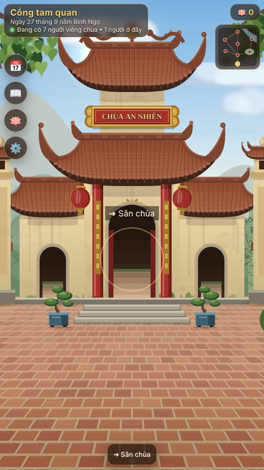
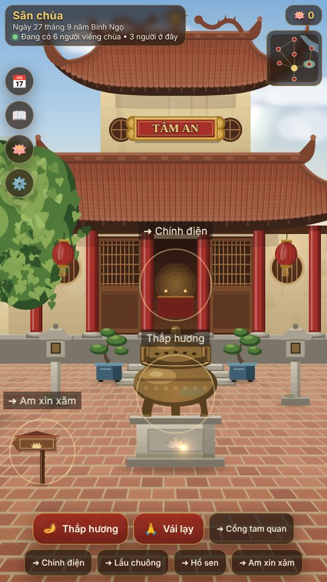
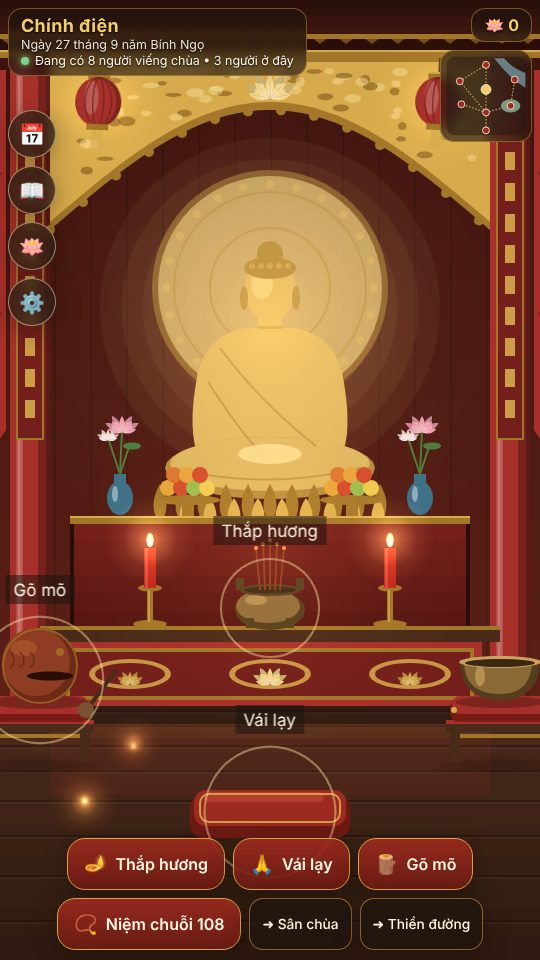
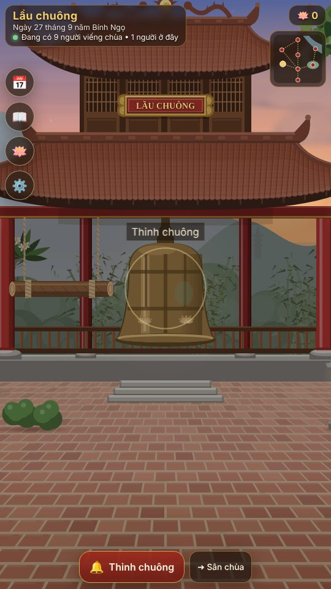
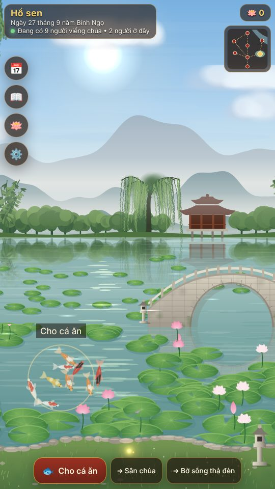
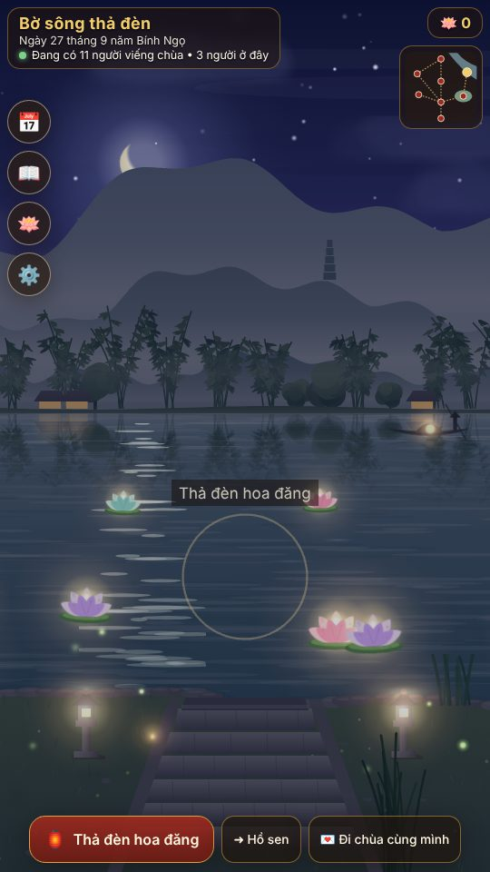
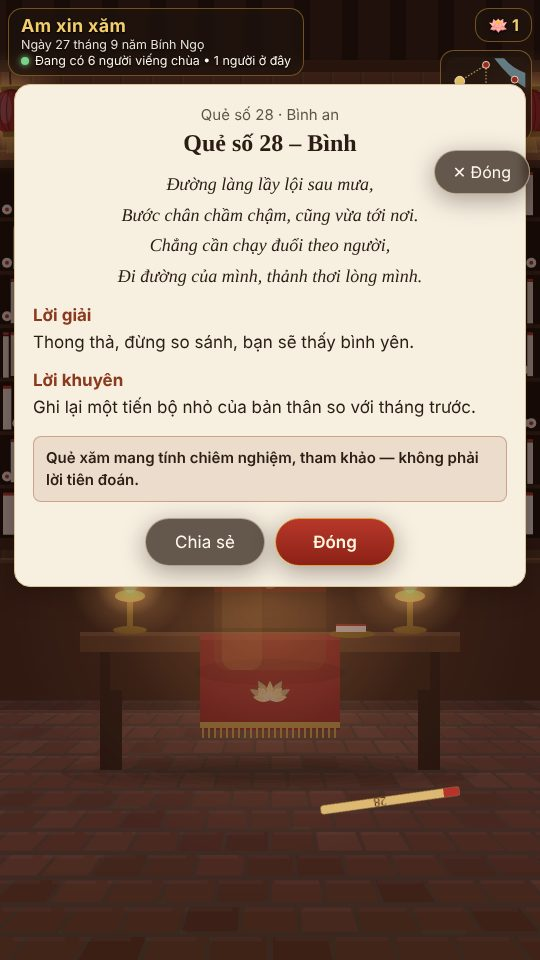
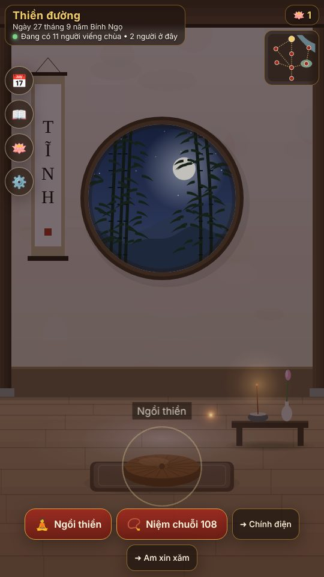

# Chùa An Nhiên

Trải nghiệm **đi chùa online** nhẹ nhàng dạng game: web PWA + Android/iOS (Capacitor), thấy người khác đang cùng viếng chùa.
Chùa An Nhiên là ngôi chùa **hư cấu** theo phong cách chùa Bắc Bộ. Mọi hình ảnh và âm thanh đều **tạo bằng mã** (Canvas/Phaser, Web Audio).

| Cổng tam quan | Sân chùa | Chính điện | Lầu chuông |
|---|---|---|---|
|  |  |  |  |
| **Hồ sen** | **Bờ sông thả đèn** | **Am xin xăm** | **Thiền đường** |
|  |  |  |  |

## Tính năng
- 8 khu, parallax 2.5D (kéo ngang để ngắm), ngày/đêm theo giờ Việt Nam, chuyển cảnh mượt, mini-map.
- Nghi thức: thắp hương (1/3/5 nén, giữ để châm, kéo cắm vào lư, khói bay theo gió), vái 3 nhịp, gõ mõ theo nhịp,
  thỉnh chuông (kéo chày, sóng âm), niệm chuỗi 108 hạt, xin xăm (lắc máy hoặc nút), thả đèn hoa đăng trên dòng sông chung,
  thiền thở 4-4-6, cho cá ăn (boids).
- Âm thanh tổng hợp 100% bằng Web Audio: đại hồng chung, mõ, khánh, gió, nước, chim, côn trùng đêm, nhạc ngũ cung.
- Âm lịch Việt Nam tự cài (Meeus, UTC+7), màn **Hôm nay**: thông điệp ngày, 3 việc nhẹ, chuỗi ngày (nghỉ 1 ngày/tuần không mất chuỗi),
  sự kiện âm lịch (mùng 1, rằm, Tết, Phật Đản, Vu Lan…) có trang trí riêng.
- Nhật ký an lạc (IndexedDB), **Hạt sen** đổi đồ trang trí (loại hương, mẫu đèn, nhạc nền, giao diện mùa). Không có tiền thật.
- Online: số người đang viếng (tổng & từng khu), hương/chuông/đèn của người khác; lọc từ xấu, Báo cáo, Chặn, Xóa dữ liệu của tôi.
  Có MockServer chạy ngay trong trình duyệt để chơi offline.
- Chia sẻ ảnh 1080×1920 (quẻ xăm, đèn, chuỗi ngày), link mời "Đi chùa cùng mình" mở thẳng ra bờ sông.
- Tiếng Việt (mặc định) + English; chữ lớn, tương phản cao, giảm chuyển động, tắt âm/rung, nút ≥ 44px.

**Tôn trọng:** tượng Phật chỉ là bối cảnh (không có thao tác bấm), không quảng cáo trong chính điện/thiền đường,
không cúng dường bằng tiền, không bán may mắn; quẻ xăm ghi rõ *mang tính chiêm nghiệm, tham khảo*.

## Chạy app
```bash
cd app
npm install
npm run dev        # http://localhost:5173  (?skip&area=bo-song&ritual=lantern&hour=21 để thử nhanh)
npm test           # Vitest
npm run build      # dist/ (PWA, chơi offline)
npm run e2e        # Playwright smoke
npm run e2e:server # e2e với server thật (cd server && npm start trước; E2E_SERVER_URL mặc định :8080)
```
Cấu hình (biến môi trường Vite): `VITE_SERVER_URL` (server Socket.IO thật; để trống → MockServer),
`VITE_ONLINE_FEATURES`, `VITE_USE_MOCK_SERVER`, `VITE_PUBLIC_URL`. App không có quảng cáo.

Đo hiệu năng trên máy thật: thêm `?fps` vào URL để hiện bộ đếm FPS.

Mobile: `npm run cap:sync` rồi `npx cap open android|ios`. Xem [docs/app/PUBLISHING.md](docs/app/PUBLISHING.md).

## Tài liệu
- [PLAN.md](PLAN.md) · [HANDOFF.md](HANDOFF.md)
- [docs/app/ARCHITECTURE.md](docs/app/ARCHITECTURE.md) · [docs/app/DECISIONS.md](docs/app/DECISIONS.md) · [docs/app/PUBLISHING.md](docs/app/PUBLISHING.md)

Repo có các phần khác do các phiên song song phụ trách: `server/`, `shared/`, `admin/` (backend), `content/`, `site/`, `store/` (nội dung), `qa/`.
